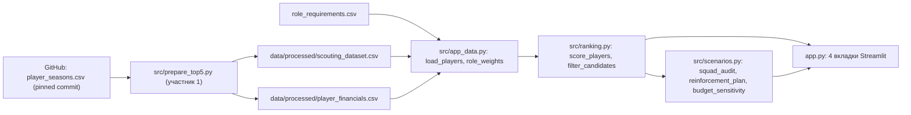
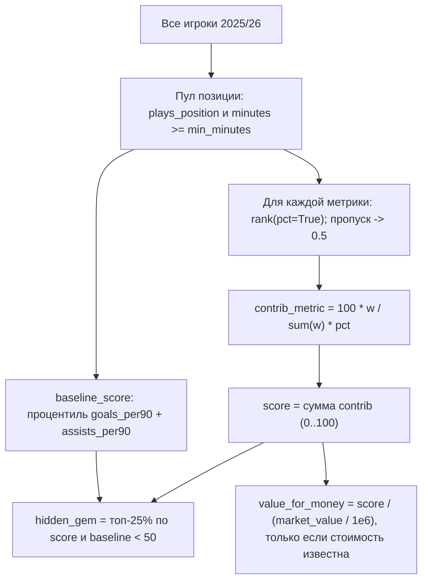

# Трансферный аудит Manchester United: как устроен проект (часть участника 2)

Документ объясняет от начала до конца, что сделано в репозитории `footballAudit`
со стороны участника 2 (приложение и сравнение кандидатов), как это работает, какие
решения и почему были приняты, что показали реальные данные и что говорить на защите.

Содержание

1. Задача и роль участника 2
2. Что уже было в репозитории: пайплайн участника 1 и контракт данных
3. Решения, принятые до написания кода
4. Архитектура и поток данных
5. Модуль за модулем
   - 5.1 `src/app_data.py` — загрузка и объединение таблиц
   - 5.2 `role_requirements.csv` — тактическая модель (веса ролей)
   - 5.3 `src/ranking.py` — рейтинг кандидатов
   - 5.4 `src/scenarios.py` — аудит состава и сценарий усиления
   - 5.5 `app.py` — интерфейс Streamlit
6. Тесты: что именно они защищают
7. Что показали реальные данные (Manchester United, сезон 2025/26)
8. Три отклонения от первоначального плана и почему
9. Ограничения и типичные ловушки футбольной аналитики: как учтены
10. Как запустить и воспроизвести; состояние Git
11. Точки интеграции с участником 1
12. Шпаргалка к защите: вопросы и ответы
13. Использование AI и что нужно проверить самостоятельно

---

## 1. Задача и роль участника 2

Проект реализует **Сценарий №1** из задания (аналитический отдел клуба перед трансферным
окном) на **уровне 3 — Decision Intelligence**: это не отчёт, а интерактивный инструмент
поддержки решений для спортивного директора. Пользователь выбирает клуб и позицию, задаёт
тактическую модель (веса метрик), бюджет и фильтры — и получает:

- аудит текущего состава на позиции (кто силён, кто слаб, где нет глубины);
- ранжированный список кандидатов с объяснением, из чего складывается рейтинг;
- сравнение игроков «свой против чужого» на радаре;
- сценарий усиления в рамках бюджета с ответом на вопрос «что изменится при −20 %».

Работа разделена по инструкции из задания. Участник 1 отвечает за данные
(`src/data_loader.py`, `src/validation.py`, `src/preprocessing.py`, `src/top5_source.py`,
`src/prepare_top5.py`, `src/pipeline.py`, тесты к ним). Участник 2 — за приложение и логику
решений: `app.py`, `src/ranking.py`, `src/scenarios.py`, `tests/test_ranking.py`, а также
(по договорённости о «общих файлах») `requirements.txt`, `role_requirements.csv` и раздел
README о запуске приложения. Дополнительно создан `src/app_data.py`, чтобы `app.py` и
`ranking.py` оставались короткими и читаемыми.

Главная установка: код должен быть небольшим, прозрачным и объяснимым. Каждое число в
интерфейсе можно разложить на слагаемые и повторить руками.

---

## 2. Что уже было в репозитории: пайплайн участника 1 и контракт данных

Перед началом работы код участника 1 был прочитан полностью, а исходный датасет —
загружен и изучен скриптами. Ниже — то, на что опирается приложение.

### 2.1 Источник данных

- Датасет [Top-5 European Leagues](https://github.com/m-mahadi/top5-football-dataset),
  файл `data/master/player_seasons.csv`, зафиксированный коммит
  `8940299c2c56c2c0932d3caf292336f5e1689893` (чтобы результат был воспроизводим).
- Размер: **5 693 строки × 220 колонок**. Одна строка = игрок × клуб × сезон.
- Сезоны: 2024/25 (2 854 строки) и 2025/26 (2 839 строк). Лиги: Серия А, Ла Лига, АПЛ,
  Лига 1, Бундеслига — всего 96 клубов в сезоне 2025/26.
- Колонки с префиксами по источнику: `fb_` — FBref (голы, передачи, удары), `us_` —
  Understat (xG, npxG, xA), `ss_` — SofaScore (передачи, отборы, единоборства,
  физика), `fifa_` — SoFIFA / EA FC 26 (рейтинги, стоимость, зарплата, контракт).
- Позиции в формате FBref: `DF`, `MF`, `FW`, `GK` и комбинации `MF,FW`, `DF,MF` и т. д.
  Распределение (оба сезона): MF 1 824, DF 1 454, FW 762, `MF,FW` 435, GK 406,
  `FW,MF` 289, `DF,MF` 278, `MF,DF` 236.

### 2.2 Что делает пайплайн участника 1 (`python -m src.prepare_top5`)

1. Скачивает исходный CSV в `data/raw/player_seasons.csv` и проверяет обязательные
   колонки (`league`, `season_label`, `team`, `player`, `nation`, `pos`, `age`,
   `nineties`, `playing_time_starts`, `playing_time_min`, `ss_player_id`).
2. `prepare_player_stats` переименовывает выбранные метрики в проектные имена
   (например, `fb_gls -> goals`, `us_np_xg -> npxg`, `ss_keyPasses -> key_passes`,
   `ss_successfulDribbles -> dribbles_completed`, `ss_aerialDuelsWonPercentage ->
   aerial_duels_won_pct`), приводит `Manchester Utd` к `Manchester United`, считает
   показатели на 90 минут **только** для игроков с `minutes >= 450` (иначе `NaN`) и
   ставит флаг `minutes_eligible`.
3. Создаёт два идентификатора:
   - `record_id` — SHA-256 от `league|season|team|player` (20 символов): уникальный ключ
     строки, по нему приложение соединяет таблицы;
   - `player_id` — ID SofaScore, а если его нет — запасной ключ
     `name:<имя>|nation:<страна>`; источник записан в `player_id_source`
     (в 2025/26: 2 714 строк с SofaScore ID, 125 — запасной ключ).
4. `prepare_player_financials` выносит EA-данные в **отдельную** таблицу
   (`ea_value_eur`, `ea_wage_eur`, `ea_release_clause_eur`, `ea_contract_start_year`,
   `ea_contract_end_year`) с текстовым предупреждением `financial_snapshot`: это снимок
   EA FC 26 без даты, не исторические финансы на дату решения 2026-06-01.
5. `prepare_scouting_dataset` — спортивная таблица только за 2025/26.

Итоговые файлы в `data/processed/` (git-ignored, создаются локально):

| Файл | Строк | Назначение |
|---|---|---|
| `player_stats.csv` | 5 693 | оба сезона, спортивные метрики |
| `player_stats_2024_25.csv` | 2 854 | срез сезона |
| `player_stats_2025_26.csv` | 2 839 | срез сезона |
| `player_financials.csv` | 2 839 | EA-снимок, 2025/26 |
| `scouting_dataset.csv` | 2 839 | **вход приложения**: 2025/26, 47 колонок, без финансов |

Файлы `src/pipeline.py`, `src/preprocessing.py`, `src/validation.py` — это общий
пайплайн под «контракт players.csv» из задания (работает на `data/sample_players.csv`).
Приложение его не использует: реальные данные идут через `top5_source.py`.

### 2.3 Фактический контракт данных, на который опирается приложение

`scouting_dataset.csv` (47 колонок):

- идентичность: `record_id`, `player_id`, `player_id_source`, `player_name`, `team`,
  `league`, `season`, `position`, `nation`, `age`;
- игровое время: `minutes`, `starts`, `nineties`, `minutes_eligible`;
- сырые суммы за сезон: `goals`, `assists`, `shots`, `xg`, `npxg`, `xa`, `key_passes`,
  `dribbles_completed`, `tackles`, `interceptions`, `aerial_duels_won`, `clearances`,
  `top_speed_kmh`, `distance_covered_km`, `sprints`;
- проценты: `pass_accuracy_pct`, `aerial_duels_won_pct`, `ground_duels_won_pct`;
- на 90 минут: `<метрика>_per90` для всех сумм, кроме скорости.

`player_financials.csv`: `record_id`, `player_id`, `player_name`, `team`, `league`,
`season`, `financial_snapshot`, `ea_*`.

Важные факты о данных, проверенные скриптами:

- медиана минут в 2025/26 — 1 074; порог 450 минут проходят 70 % строк;
- EA-стоимость известна у **85 %** игроков 2025/26, у 15 % её нет;
- пропуски по метрикам: xG/npxG/xA — 5,7 %, SofaScore-метрики — 4,4 %, физика — 7,4 %;
- возраст пропущен у 2 игроков;
- join `scouting_dataset` ↔ `player_financials` по `record_id` покрывает 100 % строк;
- игрок, сменивший клуб среди сезона, присутствует двумя строками (например, Марк Гехи:
  «Кристал Пэлас» 1 800 мин и «Манчестер Сити» 1 350 мин);
- вратарских метрик (сейвы, пропущенные) в scouting-таблице нет.

---

## 3. Решения, принятые до написания кода

Три вопроса были заданы до старта, ответы определили дизайн:

| Вопрос | Решение | Почему |
|---|---|---|
| Какой клуб и позиции | Manchester United; DF / MF / FW | Клуб уже «зашит» в пайплайне участника 1 (нормализация имени); GK невозможен без вратарских метрик |
| Как использовать финансы EA | Подключить как `market_value` / `salary` с явным дисклеймером; пропуск = «неизвестно», не 0 | Иначе бюджетный сценарий невозможен; честная пометка важнее отказа от данных |
| Язык | UI на русском, код/докстринги/README на английском | Защита на русском; код в стиле участника 1 |

Дополнительные правила, зафиксированные в плане:

- Позиция `MF,FW` означает, что игрок попадает в пул **каждой** из своих позиций.
- Процентили считаются по **всему** пулу позиции (все 5 лиг), а не по отфильтрованному
  подмножеству: фильтры не должны менять оценку игрока.
- Ветка `feature/streamlit-app` создана от `feature/data-pipeline`, потому что `main`
  в репозитории пустой, а приложению нужны `src/` и `requirements.txt` участника 1.

---

## 4. Архитектура и поток данных



Файлы участника 2 и их размер:

| Файл | Строк | Роль |
|---|---|---|
| `src/app_data.py` | 67 | загрузка, join, чтение весов |
| `src/ranking.py` | 92 | рейтинг и фильтры |
| `src/scenarios.py` | 122 | аудит, план усиления, чувствительность |
| `app.py` | 249 | интерфейс |
| `role_requirements.csv` | 21 | веса ролей |
| `tests/test_ranking.py` | 8 тестов | рейтинг и фильтры |
| `tests/test_scenarios.py` | 5 тестов | сценарии |

Вся логика живёт в `src/`, `app.py` только собирает ввод и показывает результат.
Поэтому любую функцию можно вызвать из обычного Python-скрипта или теста без Streamlit.

---

## 5. Модуль за модулем

### 5.1 `src/app_data.py` — загрузка и объединение таблиц

Константы:

- `SCOUTING_FILE`, `FINANCIALS_FILE`, `ROLE_FILE` — пути к входным файлам.
- `FINANCIAL_COLUMNS = {"ea_value_eur": "market_value", "ea_wage_eur": "salary",
  "ea_contract_end_year": "contract_end"}` — какие EA-колонки берём и как называем.
- `FINANCIAL_DISCLAIMER` — текст предупреждения, который выводится в шапке приложения.
- `SUPPORTED_POSITIONS = ("DF", "MF", "FW")`.

Функции:

- `plays_position(position, token)` — для серии строк вида `"MF,FW"` возвращает `True`,
  если `token` есть среди частей после `split(",")`. Это единственное правило разбора
  позиций во всём проекте.
- `load_players()` — читает обе таблицы (`encoding="utf-8-sig"`, как у участника 1),
  из финансовой берёт только `record_id` + три колонки, переименовывает и делает
  `merge(how="left")` по `record_id`. Левый join гарантирует, что ни один игрок не
  потеряется, даже если финансов нет: у него просто будет `NaN`. Если файла нет —
  `FileNotFoundError`, который приложение показывает как подсказку «запустите
  `python -m src.prepare_top5`».
- `load_role_requirements()` — читает `role_requirements.csv` и проверяет наличие
  колонок `position, metric, weight, label`.
- `role_weights(roles, position)` — словарь `{метрика: вес}` для позиции.
- `metric_labels(roles)` — словарь `{метрика: русская подпись}` для интерфейса.

### 5.2 `role_requirements.csv` — тактическая модель

Формат: `position,metric,weight,label`. Это «требования к роли» из задания: что клуб
ценит в игроке на позиции. Веса — экспертное допущение, их можно менять слайдерами
вживую; по умолчанию:

| Позиция | Метрика | Вес | Зачем |
|---|---|---|---|
| FW | `npxg_per90` | 0.30 | качество моментов без пенальти — главный сигнал нападающего |
| FW | `goals_per90` | 0.15 | реализация |
| FW | `shots_per90` | 0.10 | объём угроз |
| FW | `xa_per90` | 0.15 | создание моментов партнёрам |
| FW | `key_passes_per90` | 0.10 | |
| FW | `dribbles_completed_per90` | 0.10 | игра 1 в 1 |
| FW | `aerial_duels_won_pct` | 0.10 | игра в воздухе |
| MF | `xa_per90` | 0.20 | созидание |
| MF | `key_passes_per90` | 0.15 | |
| MF | `pass_accuracy_pct` | 0.15 | контроль мяча |
| MF | `npxg_per90` | 0.10 | подключения к атаке |
| MF | `dribbles_completed_per90` | 0.10 | продвижение через обводку |
| MF | `tackles_per90` | 0.15 | работа без мяча |
| MF | `interceptions_per90` | 0.15 | |
| DF | `tackles_per90` | 0.20 | |
| DF | `interceptions_per90` | 0.20 | чтение игры |
| DF | `clearances_per90` | 0.15 | |
| DF | `aerial_duels_won_pct` | 0.20 | |
| DF | `ground_duels_won_pct` | 0.15 | |
| DF | `pass_accuracy_pct` | 0.10 | первый пас |

Сумма весов в каждой группе равна 1, но код этого не требует: веса нормируются на
сумму (см. 5.3), поэтому слайдеры можно двигать свободно.

Почему нет `progressive_passes`: их нет в исходной таблице, участник 1 не стал их
выдумывать. Почему в DF нет `goals`: оценивать защитников по голам — ошибка «одни
критерии для всех позиций» из списка ловушек задания.

### 5.3 `src/ranking.py` — рейтинг кандидатов

#### Идея

Метрики измеряются в разных единицах (xA за 90, проценты, отборы за 90). Чтобы их
складывать, каждая переводится в **процентиль внутри пула позиции**: 0.8 означает
«лучше 80 % игроков этой позиции в пяти лигах». Рейтинг — взвешенное среднее
процентилей, умноженное на 100.



#### `score_players(players, position, weights, min_minutes=450)` по шагам

1. Убираются метрики с весом 0 (слайдер в нуле = метрика не участвует). Если
   положительных весов нет — `ValueError`, приложение покажет предупреждение.
2. Проверяется, что все метрики есть в таблице, иначе `ValueError` с их списком.
3. Пул: `plays_position(position) & minutes >= min_minutes`.
4. Для каждой метрики: `pct = pool[metric].rank(pct=True)`. Пропуск метрики у игрока
   заменяется на **0.5** (нейтрально) и считается в `n_missing_metrics` — в интерфейсе
   видно, у кого рейтинг частично «дорисован». Сохраняются `pct_<metric>` (для радара)
   и `contrib_<metric> = 100 * weight / total_weight * pct` (для разложения рейтинга).
5. `score` = сумма вкладов. Диапазон 0–100 по построению.
6. `baseline_score` — процентиль простого показателя `goals_per90 + assists_per90`.
   Это «наивный скаут», с которым мы сравниваем модель: задание требует показать, чем
   система лучше простого рейтинга.
7. `hidden_gem` = игрок в верхней четверти по `score` **и** ниже медианы (50) по
   `baseline_score`. Читается так: «по голам и передачам его пропустят, по роли он в
   топ-25 %».
8. `value_for_money = score / (market_value в млн €)` только там, где стоимость известна
   и больше нуля. Неизвестная стоимость даёт `NaN`, а не бесконечно выгодного игрока.
9. Результат сортируется по `score` по убыванию.

#### Разбор на реальном примере

Fermín López (Barcelona), пул MF, порог 900 минут, веса по умолчанию (сумма 1.0):

| Метрика | Значение | Процентиль | Вес | Вклад = 100 × вес × pct |
|---|---|---|---|---|
| xA за 90 | 0.38 | 98.45 | 0.20 | 19.69 |
| Отборы за 90 | 2.4 | 84.58 | 0.15 | 12.69 |
| Точность передач % | 87.42 | 83.04 | 0.15 | 12.46 |
| Ключевые передачи за 90 | 1.7 | 82.44 | 0.15 | 12.37 |
| npxG за 90 | 0.38 | 95.47 | 0.10 | 9.55 |
| Успешные обводки за 90 | 2.2 | 95.37 | 0.10 | 9.54 |
| Перехваты за 90 | 0.35 | 15.54 | 0.15 | 2.33 |
| **Итого** | | | 1.00 | **78.6** |

Эта таблица и есть вкладка «Из чего складывается рейтинг» в приложении: любую цифру
можно пересчитать на калькуляторе.

#### `filter_candidates(scored, exclude_team, age_range, max_value, include_unknown_value, leagues)`

Сужает уже оценённый пул, **не меняя оценки**:

- сначала оставляет по одной строке на `player_id` — отрезок сезона с наибольшим числом
  минут (решение проблемы «игрок дважды из-за зимнего перехода»);
- исключает свой клуб;
- возраст в диапазоне (игроки без возраста отсеиваются — их двое во всём датасете);
- лиги из списка;
- стоимость: `market_value <= max_value` **или** (стоимость неизвестна **и** включён
  чекбокс «показывать игроков с неизвестной стоимостью»). Так неизвестная стоимость
  никогда не трактуется как 0.

#### Почему именно так, и какие были альтернативы

- Процентили вместо z-score: устойчивы к выбросам (один игрок с аномальным xA не
  сжимает всех остальных), и их легко объяснить тренеру. Минус: теряется информация о
  величине разрыва между соседями.
- Взвешенная сумма вместо обученной модели: в данных нет «метки успеха трансфера»,
  учить модель не на чем; веса — это и есть тактическая модель клуба, их должен
  задавать человек.
- Сравнение с базой «голы+ассисты» — простейший способ показать добавленную ценность
  модели без тестовой выборки, которой здесь быть не может (нет будущего сезона).

### 5.4 `src/scenarios.py` — аудит состава и сценарий усиления

Константы: `CORE_SIZE = 3` (ядро позиции — три лучших игрока), `VETERAN_AGE = 30`,
`PROSPECT_AGE = 21`, `PROSPECT_MINUTES = 900`.

#### `squad_audit(players, scored, team, position)`

Берёт **всех** игроков клуба, покрывающих позицию (из полной таблицы, а не из пула),
и присоединяет к ним рейтинг по `record_id`. Поэтому игроки с малым числом минут
остаются в таблице с пустым рейтингом, а не исчезают — для аудита важно видеть весь
состав. Два эвристических флага (подписаны в интерфейсе как «сигнал», а не решение):

- `veteran_below_median` — возраст ≥ 30 и рейтинг ниже медианы пула: повод обсудить
  продажу или продление;
- `prospect_low_minutes` — возраст ≤ 21 и меньше 900 минут: кандидат на аренду ради
  практики.

#### `core_quality(group)` и `team_core_quality(scored)`

Качество позиции = средний рейтинг трёх лучших игроков. `team_core_quality` считает
это для всех 96 клубов и сортирует — так получается строка «10-е место из 96 клубов»
в интерфейсе. Нюанс: если у клуба в пуле меньше трёх игроков позиции, среднее берётся
по тем, кто есть.

#### `reinforcement_plan(candidates, squad, budget, n_signings=1)`

Жадный алгоритм:

1. Из кандидатов берутся только те, у кого стоимость известна; сортировка по рейтингу.
2. Идём сверху вниз: если игрок помещается в остаток бюджета — покупаем, вычитаем
   стоимость; останавливаемся, когда куплено `n_signings` или список кончился.
3. Качество ядра «до» = `core_quality(squad)`, «после» = `core_quality(squad + покупки)`.
4. Пять сильнейших кандидатов **без** стоимости возвращаются отдельно как
   `needs_valuation`: их нельзя купить автоматически, но нельзя и молча выбросить.

Пример (DF, порог 900, бюджет 80 млн €, 2 покупки): Гехи 88.5 за 48.5 млн — берём,
остаток 31.5; Ромеро 82.4 — стоимости нет, в `needs_valuation`; Пипер 82.8 за 8 млн —
берём, остаток 23.5; два слота заняты. Ядро «до»: (72.9 + 67.5 + 64.4) / 3 = 68.3;
«после»: (88.5 + 82.8 + 72.9) / 3 = 81.4.

Почему жадный, а не рюкзак (knapsack): при 1–3 покупках разница мала, а объяснить
жадный шаг «лучший, кто помещается» в разы проще. Это записано в README как
осознанная альтернатива.

#### `budget_sensitivity(candidates, squad, budget, deltas=(-0.2, 0, 0.2))`

Перезапускает план при бюджете × 0.8, × 1.0, × 1.2 и возвращает таблицу «бюджет →
покупки → потрачено → качество после». Это готовый ответ на вопрос защиты «что
изменится при уменьшении бюджета на 20 %».

### 5.5 `app.py` — интерфейс Streamlit

Структура сверху вниз:

1. Константы интерфейса: `DEFAULT_TEAM`, подписи флагов, `BASE_COLUMNS`, `COLUMN_CONFIG`
   (русские заголовки, прогресс-бары для рейтингов, формат денег в млн €).
2. `load_data()` под `@st.cache_data` — таблицы читаются один раз, а не при каждом
   движении слайдера. Если файлов нет — `st.error` с подсказкой и `st.stop()`.
3. Две вспомогательные функции: `show_players` (единый способ показать таблицу игроков:
   базовые колонки + запрошенные, деньги делятся на 1e6) и `player_options`
   (подпись «Игрок (Клуб)» → `record_id`, чтобы однофамильцы не путались).
4. Сайдбар: клуб (по умолчанию Manchester United), позиция, минимум минут (по умолчанию
   900, с подсказкой почему), фильтры кандидатов (возраст 18–29, стоимость до 60 млн,
   чекбокс неизвестной стоимости, лиги), бюджет (80 млн) и число покупок (1), раскрывающийся
   блок «Веса роли» со слайдерами. У слайдеров весов ключ `"{position}:{metric}"`, поэтому
   при смене позиции подставляются веса новой роли.
5. Расчёт: `score_players` → `squad` (свой клуб) и `candidates` (`filter_candidates`
   с исключением своего клуба).
6. Вкладки:
   - **Аудит состава** — три метрики (игроков на позиции, из них с рейтингом, качество
     ядра и место среди 96 клубов) и таблица состава с сигналами.
   - **Кандидаты** — топ-N с рейтингом, базой, флагом скрытого таланта, стоимостью,
     «рейтингом на млн €» и числом пропущенных метрик; ниже — разложение рейтинга
     выбранного игрока (горизонтальные столбцы + таблица «значение / процентиль / баллы»).
   - **Сравнение** — мультиселект 2–4 игроков (по умолчанию два лучших своих и лучший
     кандидат), радар процентилей (plotly) и таблица исходных значений.
   - **Сценарий усиления** — потрачено / остаток / качество до и после, таблица покупок,
     блок «нужна оценка стоимости», таблица чувствительности к бюджету, подпись с
     описанием алгоритма.
   - **Вычисления** — отдельное окно, где показано, как из весов слева получаются
     результаты справа (см. 5.6).
7. Раскрывающийся блок «Ограничения и допущения» внизу.

Технические детали: используется `width="stretch"` (появился в Streamlit 1.49, отсюда
`streamlit>=1.49` в `requirements.txt`); `plotly` нужен для радара и столбцов вклада;
никаких других зависимостей.

### 5.6 Вкладка «Вычисления» и `src/explain.py`

Идея вкладки: слева — метрики и веса (тактическая модель), справа — результаты; здесь
между ними показан весь путь числа. Все таблицы считаются теми же функциями, что и
результаты, — это не пересказ, а промежуточные значения реального расчёта. Чистые
функции лежат в `src/explain.py` (без Streamlit, покрыты тестами), `app.py` только
выводит их.

Пять блоков вкладки:

1. **Формула и веса.** Формула `score = Σ 100 · w_i / Σw · pct_i`; таблица «вес со
   слайдера → доля веса → максимум баллов» (`weight_table`); таблица значений метрик
   на 25-м, 50-м, 75-м и 90-м процентилях пула (`pool_quantiles`) — она переводит
   «процентиль 95» обратно в единицы: например, для MF xA 0.26 за 90 — это уже 90-й
   процентиль. Ниже — **разбор одного игрока уравнениями** (`score_derivation`): для
   выбранного кандидата каждая метрика записана как
   `значение → ранг из N → 100 · w/Σw · ранг/N = 100 · доля · процентиль = баллы`,
   например для Фермина Лопеса `xA = 0.38 → ранг 826 из 839 → 100 · 0.20/1.00 · 826/839
   = 19.69`, и итоговая строка `19.69 + 12.37 + … = 78.6`. N — число игроков пула, у
   которых метрика есть, поэтому у Understat-метрик (839) и SofaScore-метрик (843)
   оно разное.
2. **Аудит.** Три лучших игрока клуба с рейтингами и уравнение среднего
   `(69.6 + 66.3 + 65.2) / 3 = 67.0`; таблица лидеров по качеству ядра со строкой
   клуба (откуда «15-е место из 96»); сводка по всем трём позициям клуба
   (`positions_overview`) и вывод «слабее всего позиция X»; правила сигналов с
   текущей медианой пула.
3. **Кандидаты.** Воронка фильтров (`candidate_funnel`): пул → один отрезок сезона на
   игрока → без своего клуба → возраст → лиги → стоимость, с числом оставшихся игроков
   на каждом шаге; столбчатая диаграмма со стеком вкладов метрик для первых десяти
   кандидатов — видно, за счёт чего лидер опережает второго; фраза про две главные
   метрики лидера и численная граница «скрытого таланта».
4. **Сравнение.** Для выбранных на вкладке «Сравнение» игроков — таблица «макс. баллов
   / баллы каждого / Δ к первому» по метрикам (`score_gap`) и фраза вида «Доргу против
   Амада: −3.3; больше всего добавляют отборы (+8.5), отнимает точность передач (−10.1)».
   Далее каждая разница записана уравнением «макс. баллов × (процентиль B − процентиль A)»,
   например `15.0 · (0.9561 − 0.3891) = +8.51` для отборов, и итог `ΣΔ = 66.3 − 69.6 = −3.3`.
   Сумма столбца Δ равна разнице рейтингов — это проверяется тестом.
5. **Сценарий.** Журнал жадного выбора (`plan_steps` в `scenarios.py`): каждая строка —
   кандидат, его рейтинг и стоимость, остаток бюджета до и после и решение («куплен»,
   «дороже остатка», «стоимость неизвестна — на оценку», «слоты заняты»). Ниже —
   остаток бюджета после каждой покупки уравнениями (`80.0 − 7.0 = 73.0`), состав ядра
   до и после с уравнениями среднего и тот же проход при бюджете −20 % с объяснением,
   почему выбор изменился или нет.

Техническое изменение в `scenarios.py`: `reinforcement_plan` теперь строится поверх
`plan_steps` и хранит журнал в поле `steps`, то есть объяснение и результат получаются
из одного прохода, а не из двух разных реализаций.

---

## 6. Тесты: что именно они защищают

Все тесты работают на маленьких синтетических таблицах в памяти — так их можно читать
как спецификацию. Всего в проекте 29 тестов (11 участника 1 + 18 участника 2), все
проходят: `python -m pytest`.

`tests/test_ranking.py`:

| Тест | Что гарантирует |
|---|---|
| `test_scores_are_bounded_and_low_minute_players_are_excluded` | рейтинг в [0, 100]; игрок со 100 минутами не попадает в пул; худший — внизу |
| `test_weights_change_the_order_and_contributions_add_up` | при весе только на xA лидирует «созидатель», только на отборах — «разрушитель»; сумма `contrib_*` равна `score` |
| `test_multi_position_player_is_scored_in_each_position_pool` | `MF,FW` попадает и в пул MF, и в пул FW |
| `test_hidden_gem_flags_player_the_naive_benchmark_misses` | флаг ставится игроку без голов/передач, но с топ-отборами, и не ставится результативному |
| `test_unknown_value_is_not_treated_as_zero` | без стоимости `value_for_money` пустой; дешёвый хороший игрок выгоднее дорогого |
| `test_filters_respect_budget_and_unknown_value_switch` | фильтр по стоимости включает/исключает «неизвестных» по чекбоксу; возраст, лига и свой клуб работают |
| `test_mid_season_transfer_keeps_only_the_longest_stint` | у игрока с двумя клубами остаётся отрезок с большим числом минут |
| `test_missing_metric_or_zero_weights_are_rejected` | понятные ошибки на отсутствующую метрику и нулевые веса |

`tests/test_scenarios.py`:

| Тест | Что гарантирует |
|---|---|
| `test_plan_stays_within_budget_and_improves_core_quality` | покупки не превышают бюджет; потрачено/остаток сходятся; качество «после» считается верно |
| `test_unpriced_players_are_flagged_instead_of_bought` | игрок без стоимости не покупается даже при бюджете 500 млн, а попадает в `needs_valuation` |
| `test_budget_cut_of_20_percent_changes_the_signing` | при −20 % выбор меняется с дорогого на доступного; потрачено ≤ бюджета во всех строках |
| `test_squad_audit_keeps_low_minute_players_and_flags_heuristics` | игрок с 200 минутами остаётся в аудите без рейтинга; флаги ветерана и проспекта ставятся по правилам |
| `test_team_core_quality_ranks_teams_by_their_best_players` | клубы сортируются по среднему топ-N |
| `test_plan_steps_record_every_greedy_decision` | журнал жадного выбора фиксирует «дороже остатка», «нет стоимости», «куплен» и остаток после каждого шага |

`tests/test_explain.py`:

| Тест | Что гарантирует |
|---|---|
| `test_weight_table_normalises_to_100_points` | доли весов дают в сумме 1, максимумы баллов — 100 |
| `test_funnel_counts_never_increase_and_end_at_candidate_count` | воронка не растёт и заканчивается числом кандидатов |
| `test_score_gap_adds_up_to_the_score_difference` | сумма баллов игрока равна его рейтингу; сумма Δ равна разнице рейтингов |
| `test_score_derivation_reproduces_rank_percentile_and_points` | ранг = процентиль × N, баллы = 100 × доля × процентиль, сумма баллов = рейтинг |
| `test_pool_quantiles_reports_requested_percentiles` | таблица процентилей содержит 25/50/75/90 и медиана совпадает с ручным расчётом |

---

## 7. Что показали реальные данные (Manchester United, сезон 2025/26)

Все числа ниже получены запуском кода на `data/processed/*` при настройках по
умолчанию (порог 900 минут, возраст 18–29, стоимость ≤ 60 млн €, все лиги,
бюджет 80 млн €).

### 7.1 Состав по позициям

| Позиция | Пул | Качество ядра MU | Место из 96 | Лидеры по ядру |
|---|---|---|---|---|
| DF | 605 | 68.3 | 10 | Crystal Palace 74.6, Man City 73.6, Monaco 72.4 |
| MF | 878 | 67.0 | 15 | Barcelona 78.7, PSG 74.9, Real Madrid 74.3 |
| FW | 380 | 61.6 | 27 | Bayern 88.7, Barcelona 85.3, PSG 84.0 |

Главный вывод аудита: **самая слабая линия — атака** (27-е место), оборона относительно
сильна (10-е). Бюджет логично направлять на FW.

Защита (DF): Мазрауи 72.9 (лучший, при этом «скрытый талант»: по голам+передачам он
в 10-м процентиле), Хэвен 67.5 (18 лет), де Лигт 64.4, Йоро 62.1, Магуайр 57.5,
Шоу 56.1, Л. Мартинес 55.3 (EA-стоимости нет), Далот 54.3; Фредриксон и Маласия без
рейтинга (3 и 18 минут).

Полузащита (MF): Амад 69.6 (скрытый талант, стоимости нет), Доргу 66.3, Бруно
Фернандеш 65.2, Каземиро 59.6, Кунья 56.2, Маунт 56.2, Майну 55.9, Далот 53.3,
Мазрауи 47.9, Мбёмо 47.4. Без рейтинга: Угарте (887 минут — на 13 минут меньше
порога), Зиркзее (626), трое 17–18-летних с флагом «аренда?».

Нападение (FW): Шешко 64.6, Мбёмо 62.4, Кунья 57.8; Зиркзее и Лейси без рейтинга.
Всего три нападающих с рейтингом — глубины нет.

### 7.2 Кандидаты (первые строки)

DF: Марк Гехи (Crystal Palace, 25, 88.5, 48.5 млн), Амос Пипер (Werder, 27, 82.8,
8 млн, скрытый талант), Кристиан Ромеро (Tottenham, 82.4, стоимости нет), Ардиан
Исмайли (Torino, 80.8, 3.6 млн), Виктор Нельссон (Verona, 80.4, 4.6 млн), Давид
Аффенгрубер (Elche, 24, 79.6, 10.5 млн), Садибу Сане (Metz, 21, 78.9, 3.3 млн),
Тьяго Габриэл (Lecce, 20, 77.4, 2.9 млн).

MF: Фермин Лопес (Barcelona, 22, 78.6, 7 млн по EA), Арда Гюлер (Real Madrid, 20,
78.4, 56.5 млн), Ламин Камара (Monaco, 21, 78.0, 28 млн), Сенни Маюлю (PSG, 19,
77.0, 22.5 млн), Камори Думбия (Brest, 22, 75.2, 9 млн), Миттельштедт (Stuttgart,
75.2, 33 млн), Лонгстафф (Leeds, 74.0, 8 млн), Блас (Rennes, 73.5, 8 млн),
Андре Алмейда (Valencia, 25, 73.0, 5.5 млн, скрытый талант).

FW: Антуан Семеньо (Man City, 25, 87.2, 50.5 млн), Николас Джексон (Bayern, 24,
84.7, 24.5 млн), Маркус Тюрам (Inter, 82.5, 58.5 млн), Ансу Фати (Monaco, 22, 82.4,
9 млн), Маркус Рэшфорд (Barcelona, 81.0), Саид Эль-Мала (Köln, 18, 80.6, 16 млн),
Амин Гуири (Marseille, 80.5), Пулишич (Milan, 80.3), Ундав (Stuttgart, 80.1),
Крстович (Atalanta, 78.5, 10 млн).

### 7.3 Сценарий усиления при 80 млн €

| Позиция | 1 покупка | Ядро до → после | 2 покупки | Ядро после |
|---|---|---|---|---|
| DF | Гехи, 48.5 млн | 68.3 → 76.3 | Гехи + Пипер, 56.5 млн | 81.4 |
| MF | Фермин Лопес, 7 млн | 67.0 → 71.5 | Лопес + Гюлер, 63.5 млн | 75.6 |
| FW | Семеньо, 50.5 млн | 61.6 → 71.4 | Семеньо + Джексон, 75 млн | 78.9 |

При ±20 % от 80 млн выбор не меняется ни на одной позиции: лучший кандидат стоит
заметно меньше бюджета — решение устойчиво. Чувствительность видна при малых
бюджетах: для FW при 30 млн берётся Джексон (24.5 млн, ядро 70.6), а при 24 млн — Ансу
Фати (9 млн, ядро 69.8).

### 7.4 Неожиданные и полезные для защиты находки

1. **Бруно Фернандеш**: база «голы+ассисты» 98.9, а рейтинг роли 65.2. Модель MF
   с весами на отборы и перехваты (по 0.15) его недооценивает. Это не ошибка, а
   иллюстрация: рейтинг отражает тактическую модель; сдвиньте веса в сторону xA и
   ключевых передач — он поднимется. На защите это удобно показать слайдерами.
2. **Мазрауи — лучший DF клуба** при 985 минутах и «скрытый талант»: по стандартной
   статистике он невидим, по ролевой модели — ядро. Одновременно это предупреждение о
   малой выборке: 985 минут немного.
3. **Рэшфорд числится кандидатом** (Barcelona): данные не знают, что он в аренде из
   MU. Ограничение источника, которое надо проговаривать.
4. **EA-стоимость Фермина Лопеса — 7 млн €** при реальной рыночной в разы выше.
   Показатель «рейтинг на млн €» наследует все странности EA-оценок, поэтому он
   вспомогательный, а не главный критерий.
5. **Угарте не получил рейтинг** из-за 887 минут при пороге 900 — любой порог
   произволен; поэтому порог вынесен в слайдер, а не зашит в код.
6. **При пороге 450** верхушку MF занимали игроки с 468–600 минутами (Оскар Бобб,
   Дуглас Луис) — классическое раздувание показателей на 90 минут малой выборкой.
   Именно поэтому значение по умолчанию поднято до 900 (см. раздел 8).
7. **«Скрытых талантов» среди DF 92 из 605, среди FW — 5 из 380.** База
   «голы+ассисты» почти не различает защитников, поэтому для DF флаг слабее по смыслу;
   для нападающих он, наоборот, редкий и ценный.

---

## 8. Три отклонения от первоначального плана и почему

| Было в плане | Стало | Причина |
|---|---|---|
| Порог минут по умолчанию 450 (как в пайплайне) | 900 в интерфейсе (450 остаётся порогом пайплайна) | при 450 топ кандидатов — игроки с 468–600 минутами; 900 ≈ 10 полных матчей |
| «Скрытый талант» = разрыв рангов модель−база ≥ 0.25 | топ-25 % по модели и ниже медианы по базе | первое правило помечало 32 % защитников, то есть не выделяло никого |
| Дедупликации переходов не было | в кандидатах остаётся отрезок с большим числом минут | иначе Гехи и Бобб встречались дважды в одном списке |

Все три изменения сделаны после прогона на реальных данных — это и есть «проверка
качества» для системы без тестовой выборки: смотреть, не выдаёт ли метод очевидную
ерунду, и править определение.

---

## 9. Ограничения и типичные ловушки: как учтены

| Ловушка из задания | Как проявляется здесь | Что сделано |
|---|---|---|
| Data leakage | Прогнозов нет, один сезон. Риск — финансы EA без даты снимка | финансы хранятся отдельно (участник 1), подписаны как оценки, не используются для «исторических» выводов |
| Недостаточное игровое время | per-90 у игроков с 450–600 минутами завышены | порог минут в слайдере (по умолчанию 900), игроки ниже порога видны в аудите без рейтинга |
| Разные позиции | нельзя мерить DF и FW одними метриками | отдельные веса на позицию, процентили внутри пула позиции, игрок `MF,FW` оценивается в обоих пулах |
| Разные чемпионаты | процентили смешивают 5 лиг | честно указано как ограничение; фильтр по лигам есть, поправки на силу лиги нет |
| Корреляция и причинность | высокий рейтинг роли ≠ успех трансфера | формулировки «соответствие роли», а не «сыграет лучше»; сигналы аудита названы эвристиками |
| Устаревшие данные | EA-снимок без даты; переходы среди сезона | дисклеймер в шапке; дедупликация по максимуму минут; аренды (Рэшфорд) не распознаются |
| Смещение выборки | только 5 лиг, нет чемпионшипа, Португалии, Нидерландов | указано; это ограничение источника |
| Неопределённость | веса — экспертные; у 15 % нет стоимости | веса меняются вживую; «неизвестно» никогда не превращается в 0; кандидаты без стоимости выводятся отдельно |

Два ограничения, которые сильнее всего влияют на надёжность: (1) EA-стоимости вместо
рыночных — весь бюджетный сценарий держится на них; (2) отсутствие поправки на уровень
лиги — защитник «Лечче» и защитник «Ман Сити» сравниваются напрямую.

---

## 10. Как запустить и воспроизвести; состояние Git

```powershell
cd C:\Users\Admin\Desktop\ass6\footballAudit
python -m pip install -r requirements-dev.txt   # pandas, streamlit, plotly, pytest
python -m src.prepare_top5                      # скачивает источник и создаёт data/processed/*.csv
python -m pytest                                # 23 теста
streamlit run app.py                            # http://localhost:8501
```

Состояние репозитория:

- ветка `feature/streamlit-app`, создана от `feature/data-pipeline`;
- коммит `88307cc` «Add Streamlit transfer-audit app: percentile ranking, squad audit,
  budget scenarios» содержит только файлы участника 2 плюс `requirements.txt` и
  раздел README (общие файлы по договорённости);
- `git push` не прошёл: GitHub отклонил сохранённый токен (`Invalid username or token`),
  `gh` не установлен. Нужно обновить учётные данные и выполнить:

```powershell
git push -u origin feature/streamlit-app
```

Затем открыть pull request `feature/streamlit-app -> main`. Пока ветка участника 1 не
слита в `main`, PR будет показывать и его коммит; после слияния пайплайна останутся
только изменения приложения. Порядок по заданию: сначала слить данные, потом приложение.

---

## 11. Точки интеграции с участником 1

Что нужно сообщить и согласовать:

1. Приложение читает ровно `data/processed/scouting_dataset.csv` и
   `data/processed/player_financials.csv`, соединяя их по `record_id`. Имена файлов и
   колонок — контракт; менять только вместе.
2. Используемые колонки: `record_id`, `player_id`, `player_name`, `team`, `league`,
   `position`, `age`, `minutes`, все `*_per90` и `*_pct` из `role_requirements.csv`,
   `goals_per90`, `assists_per90`, а также `ea_value_eur`, `ea_wage_eur`,
   `ea_contract_end_year`.
3. Вратари не поддерживаются: для GK нужны `saves`, `goals_conceded`, `clean_sheets`
   (в источнике есть `ss_saves`, `ss_goalsConceded`, `ss_cleanSheet`, `ss_goalsPrevented`).
4. Веса в `role_requirements.csv` — стартовое предложение; согласовать и при желании
   добавить метрики (например, `ss_ballRecovery`, `ss_accurateLongBalls`).
5. Если участник 1 подключит реальные стоимости (Transfermarkt), достаточно изменить
   `FINANCIAL_COLUMNS` в `src/app_data.py` — остальной код не трогается.

---

## 12. Шпаргалка к защите: вопросы и ответы

**Почему именно этот метод?** Нужен прозрачный рейтинг, который тренер может оспорить
по каждой метрике. Процентили делают метрики сопоставимыми и устойчивыми к выбросам,
веса явно кодируют тактическую модель. Обученной модели неоткуда взяться: в данных нет
исхода трансфера.

**Как проверяли качество?** Три уровня: модульные тесты (23), сравнение с наивной базой
«голы+ассисты» (флаг скрытых талантов и колонка базы рядом с рейтингом), проверка
здравого смысла на реальных данных, после которой изменены порог минут и определение
скрытого таланта. Плюс чувствительность к бюджету.

**Какой вывод оказался неожиданным?** Слабейшая линия MU по данным — атака (27-е место
из 96), а не оборона (10-е). И лучший защитник клуба по ролевой модели — Мазрауи, которого
статистика голов и передач ставит в 10-й процентиль.

**Что изменится при уменьшении бюджета на 20 %?** При 80 млн — ничего: лучшие кандидаты
стоят 7–50 млн. При 30 млн на FW выбор сместится с Джексона (24.5 млн) на Ансу Фати
(9 млн), качество ядра 70.6 → 69.8. Таблица «Что изменится при другом бюджете» считает
это автоматически.

**Какое ограничение сильнее всего влияет на надёжность?** Стоимости EA FC 26 вместо
рыночных: от них зависит бюджетный сценарий и «рейтинг на млн €». Второе — смешение пяти
лиг без поправки на их уровень.

**Что бы изменили при наличии дополнительных данных?** Реальные стоимости и зарплаты
(Transfermarkt/Capology), второй сезон для проверки стабильности рейтинга игрока от года
к году (это стало бы настоящей тестовой выборкой), коэффициенты силы лиг, данные о
контрактах и арендах, вратарские метрики.

**Что вы лично получили или проверили?** Ответ должен быть вашим; см. раздел 13 — там
список того, что стоит проверить руками до защиты.

**Почему жадный алгоритм, а не оптимизация?** При 1–3 покупках и явном бюджете
жадный выбор почти всегда совпадает с оптимальным, зато объясняется одной фразой.
Если потребуется 5+ покупок с ограничениями по зарплатной ведомости — это задача
рюкзака / линейного программирования, и структура кода позволяет заменить одну функцию.

**Почему медиана и процентили, а не средние?** Распределения метрик скошены
(несколько игроков с огромным xA); среднее и стандартное отклонение тянутся за ними.

---

## 13. Использование AI и что нужно проверить самостоятельно

Задание требует раскрыть использование LLM. Со стороны участника 2:

- **Для чего применялась**: анализ кода и данных участника 1, составление плана,
  написание кода `src/app_data.py`, `src/ranking.py`, `src/scenarios.py`, `app.py`,
  тестов и этого документа; подбор стартовых весов ролей.
- **Что ей предоставлялось**: текст задания, репозиторий с кодом участника 1, исходный
  датасет (через запуск скриптов), ответы на три уточняющих вопроса (клуб, финансы,
  язык).
- **Как проверялись результаты**: все 23 теста проходят; код прогнан на реальных данных
  (числа в разделе 7 получены из этих прогонов); приложение запущено и проверены все
  четыре вкладки; после прогона исправлены три определения (раздел 8).
- **Обнаруженные ограничения и риски**: см. разделы 7.4 и 9 — они найдены именно при
  проверке результатов, а не придуманы заранее.

Что стоит сделать самостоятельно перед защитой (чтобы уверенно отвечать «я проверил»):

1. Запустить `python -m pytest` и `streamlit run app.py`, пройти все вкладки для DF, MF, FW.
2. Пересчитать вручную рейтинг одного игрока по таблице «Из чего складывается рейтинг»
   (как в разделе 5.3) — убедиться, что сумма вкладов равна рейтингу.
3. Сдвинуть веса MF в сторону xA и ключевых передач и посмотреть, как поднимается Бруно
   Фернандеш — это живая демонстрация того, что рейтинг = тактическая модель.
4. Поставить порог минут 450 и увидеть, как в топ MF выходят игроки с 468–600 минутами.
5. Снять чекбокс «показывать игроков с неизвестной стоимостью» и убедиться, что
   Ромеро, Амад и Л. Мартинес пропадают из кандидатов, но остаются в аудите.
6. Уменьшить бюджет до 30 и 24 млн на FW и проверить таблицу чувствительности.
7. Прочитать `src/ranking.py` (92 строки) и `src/scenarios.py` (122 строки) целиком —
   каждую функцию можно объяснить за минуту.
